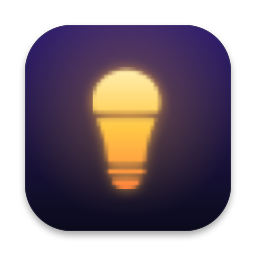

# LEDs do Mac

Controle as luzes do seu MacBook pela barra de menus: o LED do Caps Lock, a luz do teclado e o LED do carregador MagSafe.
O app fica como uma lâmpada ao lado do relógio. Sem janela, sem ícone no Dock. Grátis e open source.

## Para que serve

O macOS não deixa você mexer nessas luzes diretamente. O LEDs do Mac deixa:

- **Fixar ou apagar a luz do teclado** sem depender do sensor de luz ambiente. Por exemplo: sempre apagada para economizar bateria, ou sempre no mesmo brilho quando a luz do ambiente fica variando.
- **Usar o LED do Caps Lock como sinal**: aceso, apagado ou piscando, sem ligar o Caps Lock (o que você digita não muda).
- **Mudar a cor do LED do MagSafe**: verde, laranja ou apagado. Por exemplo: apagar a luz do carregador à noite no quarto. *(Em teste: ainda não confirmado em todos os modelos.)*

E sem pesar no Mac: parado, usa 0% de CPU e não fica verificando nada em segundo plano.

O que ele **não** faz:

- **LED da câmera:** não dá para controlar. A Apple liga essa luz direto no hardware da câmera, para ninguém conseguir filmar escondido.
- **Tecla por tecla ou cores no teclado:** a luz do teclado do MacBook é uma zona só, branca. O brilho vale para todas as teclas juntas.

## Controles

| LED | Opções | Precisa de |
|---|---|---|
| Caps Lock | Normal · Aceso · Apagado · Piscar | Permissão "Monitoramento de Entrada" (uma vez) |
| Luz do teclado | Brilho 0–100% · Automático (sensor de luz) | Nada |
| MagSafe 3 | Verde · Laranja · Apagado · Sistema | Senha de administrador a cada troca |

**Requisitos:** Mac com Apple Silicon (M1 ou mais novo), macOS 14 ou mais novo.
O MagSafe só aparece nos modelos com conector MagSafe 3.

## Instalar

Abra o **Terminal** (Aplicativos › Utilitários), cole esta linha e aperte Enter:

```bash
curl -fsSL https://raw.githubusercontent.com/CelsonF/leds-do-mac/main/install.sh | zsh
```

O [instalador](install.sh) baixa a versão mais recente, coloca o app em **Aplicativos** e abre.
Para atualizar, rode a mesma linha de novo.

> **Por que pelo Terminal?** O app não é notarizado pela Apple (isso exige uma conta paga de desenvolvedor).
> Baixado pelo navegador, o macOS diz que não pode verificar o app e oferece mover para o Lixo.
> Arquivos baixados pelo Terminal não recebem essa marca, então o app abre direto.

### Permissão do Caps Lock

Na primeira abertura, o macOS pede a permissão **Monitoramento de Entrada**: clique em
**Abrir Ajustes do Sistema**, ative "LEDs" e abra o app de novo.
Só você pode ativar essa permissão; nenhum instalador consegue fazer isso por você.

Ao atualizar, o instalador limpa a permissão antiga (que deixa de valer na versão nova) e o pedido aparece de novo.

### Instalar pelo .zip (alternativa)

1. Baixe `LEDs-do-Mac.zip` na página de [Releases](../../releases/latest), descompacte e arraste `LEDs.app` para **Aplicativos**.
2. Ao abrir, o macOS bloqueia. Vá em **Ajustes do Sistema › Privacidade e Segurança**, role até o aviso sobre "LEDs" e clique em **Abrir Mesmo Assim**.
   Ou, pelo Terminal: `xattr -dr com.apple.quarantine /Applications/LEDs.app`

## Compilar

Precisa só das Command Line Tools do Xcode (`xcode-select --install`).

```bash
./build.sh
open build/LEDs.app
```

O app é assinado ad hoc: **toda vez que recompilar**, o macOS trata como app novo e é preciso dar a permissão do Caps Lock outra vez.

## Como funciona

- `Sources/CapsLockLED.swift`: IOKit HID, escreve no elemento de LED (página 0x08, uso 0x02). Muda só a luz, não o estado do Caps Lock. A escrita roda numa fila em segundo plano, sem travar a interface. Nos modos Aceso/Apagado não há polling: um event tap que só escuta (`CapsLockWatcher`) avisa quando o Caps Lock muda e o app reaplica a luz, já que o sistema mexe no LED nessa hora. Também reaplica quando o Mac acorda. Parado, o app não acorda o processador.
- `Sources/KeyboardBacklight.swift`: `KeyboardBrightnessClient` do framework privado CoreBrightness. Mexer no brilho desliga o ajuste automático (senão o sensor de luz suprime a luz em ambiente claro).
- `Sources/MagSafeLED.swift`: chave SMC `ACLC` (1 byte: 0 sistema, 1 apagado, 3 verde, 4 laranja). Ler não precisa de root. Para escrever, o app pede a senha via `osascript` e roda o próprio executável com `--magsafe <valor>`, que só aceita esses 4 valores.

O ícone é desenhado em código (`Icon/make-icon.swift`, sem imagens externas). Depois de mudar o desenho, gere de novo `Resources/AppIcon.icns` e `Icon/preview.png`:

```bash
Icon/make-icon.sh
```

Diagnóstico pelo terminal:

```bash
/Applications/LEDs.app/Contents/MacOS/LEDs --status
```

Usa APIs privadas da Apple: uma atualização do macOS pode quebrar a luz do teclado ou o MagSafe.
Testado num MacBook Pro M5 com macOS 27.

## English

Free, open source menu bar app to control the lights on Apple Silicon MacBooks (macOS 14+). macOS doesn't let you change these lights directly; this app does:

- **Keyboard backlight:** set a fixed brightness or turn it off, without the ambient light sensor overriding it.
- **Caps Lock LED:** on, off or blinking, without turning Caps Lock on (your typing doesn't change). Needs the Input Monitoring permission.
- **MagSafe 3 LED:** green, orange or off, e.g. to turn off the charger light at night. Asks for the admin password. *(Beta: not yet confirmed on every model.)*

Idle, it uses 0% CPU and doesn't poll. It can't control the camera LED (Apple wires it to the camera in hardware) or individual keys (the keyboard backlight is a single white zone).

Install with `curl -fsSL https://raw.githubusercontent.com/CelsonF/leds-do-mac/main/install.sh | zsh` (the app is not notarized, so a browser download gets blocked by Gatekeeper), or build with `./build.sh`.

## Licença

[MIT](LICENSE)
